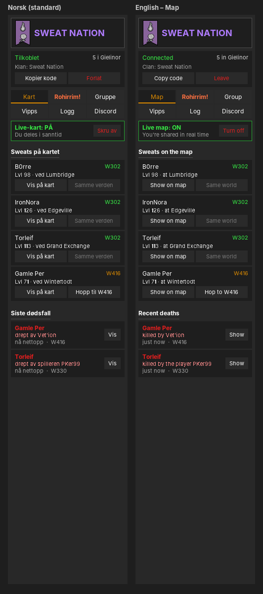
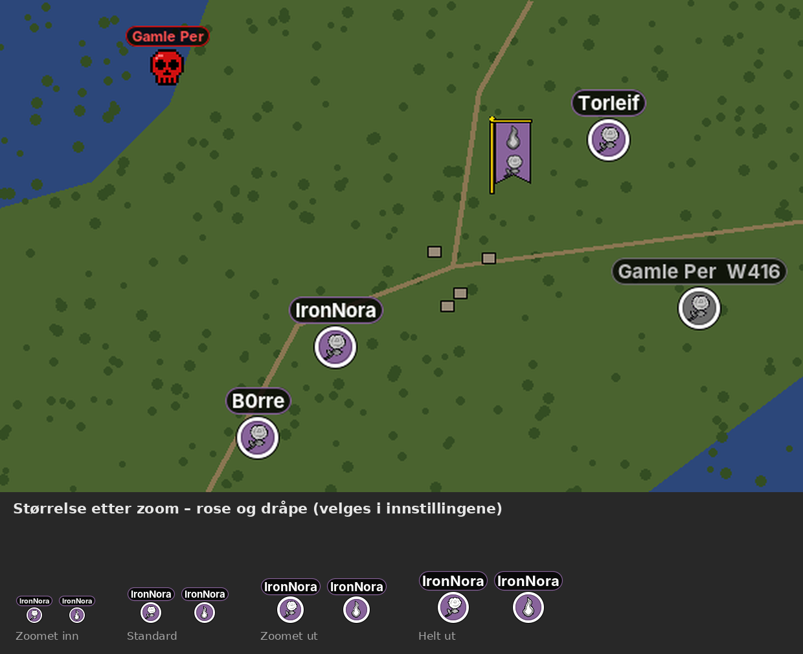

# SWEAT NATION

A RuneLite plugin for clans and groups of friends. Everyone with the plugin shares a RuneLite party, which gives you a live member map, rally calls, group lobbies, a team HUD and a shared activity log. The plugin is in Norwegian by default and can be switched to English in the settings.

*Norsk: se [README.no.md](README.no.md).*




## Features

- **Norwegian / English:** Choose "Språk / Language" at the top of the settings. The panel, map, overlays, chat messages and log switch right away. Each player sees the shared log in their own language. Setting names are shown in both languages, because RuneLite cannot change them while the client is running.
- **Live map:** Turn it on or off in the Map tab. When it is on, you share your position with your group and see the other members on the world map with a name tag. When it is off, you are hidden and don't see the others. Each player chooses their own marker icon (a rose or a drop), which is how the others see them. Double-click a member on the map, or right-click and choose "Hop to", to hop to their world.
- **Clan group:** When you join your clan chat in game, you join your clan's own SWEAT NATION group. Each clan gets its own group based on the clan name, and an optional clan secret makes the group code impossible to guess. Players without a clan, or friends across clans, can create a group and share the code instead.
- **Rohirrim! (rally call):** Call the group to your position, or right-click the world map and choose "Rally here". Everyone hears the rally sound, sees a banner on the map, an arrow and the distance, and can answer "Rohirrim!" or "Can't".
- **Fastest teleport:** During a rally, the panel shows the teleports that get you closest, based on the transport data from Shortest Path. Items you own and the runes for teleport spells glow orange in the bank, equipment and inventory. Spells on your current spellbook are included, and the rune pouch, combination runes, elemental staves and tomes are counted.
- **Groups and lobbies:** Sign up for 40+ multiplayer activities, or create your own group. A search field under the categories searches the selected category ("All" searches everything), including short names like "cox", "tob" and "gwd". Each group gets a lobby with roles (Mage, Range, Melee, Tank), adjustable group size and a 30-second ready check.
- **Team HUD:** Shows HP, prayer and special attack energy for your group, or for clan members near you outside a group. When someone uses a special attack, their weapon icon pulses. The size and distances can be set in the settings. Optionally (off by default), stat boosts and timed buffs are shown as small icons under each player, with a clock: dark for time passed, light for time left. Timed buffs are read from RuneLite's Timers & Buffs plugin.
- **Activity log:** Shows what members do: boss kills with KC, player kills in the Wilderness or on PvP worlds, loot over 500K, clues, quests, levels, pets, collection log entries and deaths (with "killed by"). It is grouped per player and stored locally in `.runelite/sweatnation/`.
- **Deaths:** A skull marks where a member died on the world map.
- **Loot split:** One player starts a split, the others join. Loot is counted automatically at GE price, and the panel shows each person's share and who pays whom. The summary can be copied.
- **Discord:** Add your clan's Discord invite in the settings to get a button that opens it. Only discord.gg and discord.com links are accepted.
- **Logged-out players:** When a clan member logs out, they leave the clan chat and stop counting as online after 10 seconds (so world hopping does not count as logging out). They stay in their groups, shown as "Logged out · 7 min" in the lobby, and are removed after 10 minutes. If they log back in before that, everything continues as normal.

## Privacy

- Positions, stats and events are only shared with the members of your RuneLite party, through RuneLite's own party service. Nothing is sent to any other server.
- The live map can be turned off at any time, and then your position is not shared.
- No Discord link or other clan information is stored in the source code.

## Installing

Open RuneLite → the wrench icon → **Plugin Hub** → search for **SWEAT NATION** → Install.

## Building and testing locally

You need a JDK 11 or newer.

```
./gradlew run          (macOS/Linux)
.\gradlew.bat run      (Windows PowerShell)
```

This starts RuneLite in developer mode with the plugin loaded. Test with at least one other person in the same clan chat or group.

## Credits

- Teleport data is derived from [Shortest Path](https://github.com/Skretzo/shortest-path) by Skretzo, BSD 2-Clause License. See `NOTICE.md` and `LICENSE-shortest-path`.

## License

BSD 2-Clause, see `LICENSE`.
