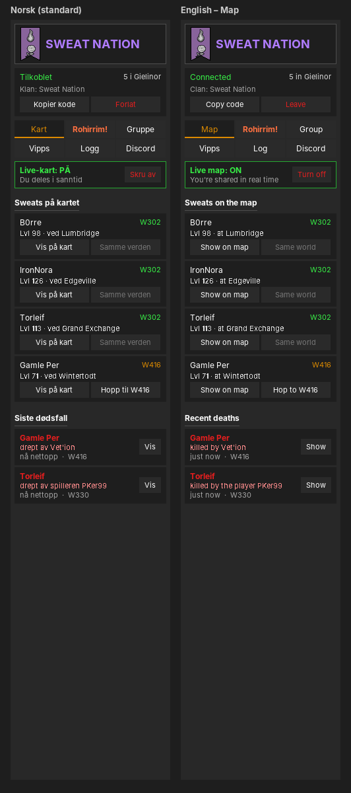
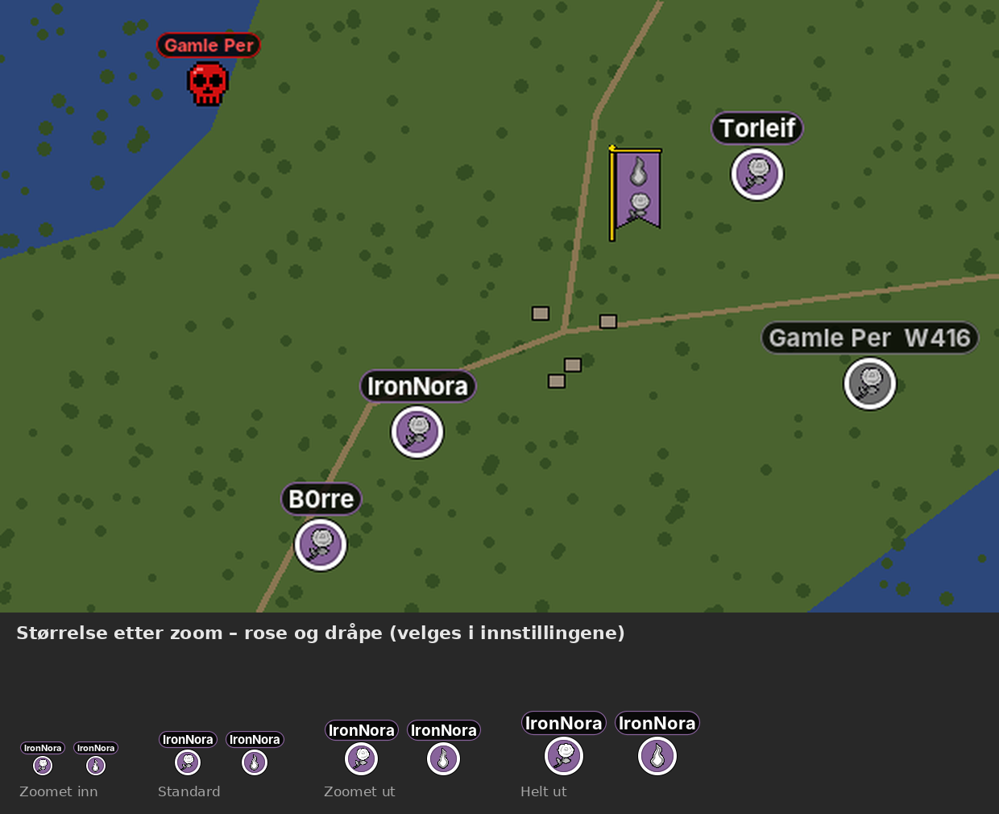

# SWEAT NATION – RuneLite-plugin for klanen

*English: see [README.md](README.md).*




## Funksjoner

- **Norsk / English:** Velg «Språk / Language» øverst i innstillingene. Norsk er standard. Panelet, kartet, overlays, chat-meldinger og loggen bytter med en gang. Hver spiller ser loggen på sitt eget språk. Tekstene i RuneLite-innstillingene vises på begge språk, fordi RuneLite ikke kan bytte dem mens spillet kjører.

- **Raskeste teleport:** Under et aktivt Rohirrim! ser du hvilken teleport-gjenstand som tar deg nærmest, og hvilken av dem du selv har. Den lyser oransje i bank, utstyr og inventory. Teleport-trylleformler for spellbooken du står på er også med. Raden viser runene som trengs, for eksempel «2 Law, 2 Fire», og runene lyser oransje der du har dem. Rune pouch, kombinasjonsruner og elementstaver eller tomes telles med. Mangler du runer, står det hvilke. Har du Shortest Path fra Plugin Hub, kan den i tillegg tegne hele ruten (eget valg).
- **Tydelige medlemsmerker:** Merket er lilla med rosen eller dråpen fra banneret og har navneskilt. Ikonet er ditt eget valg («Mitt ikon på kartet» i innstillingene), og det er slik de andre ser deg på kartet. Det blir større når du zoomer ut. Dobbeltklikk på et medlem på kartet, eller høyreklikk og velg «Hopp til», for å hoppe til verdenen deres.
- **Live-kart (som Snap Map):** Du skrur det av og på selv i panelet, under Kart. Står det på, deler du posisjonen din i sanntid og ser resten av klanen med navn og lilla prikk på verdenskartet. Står det av, er du skjult og ser ikke de andre. Posisjonen sendes omtrent hvert 1,8 sekund mens du beveger deg (hver 3. game tick).
- **Auto-join for alle klaner:** Når du kobler til klanchatten i spillet, blir du automatisk med i klanens egen SweatNation-gruppe. Hver klan får sin egen gruppe ut fra klannavnet, så andre klaner som bruker pluginen, havner aldri sammen med dere. Kobler du fra klanchatten, forlater du gruppa.
- **Egne grupper:** Spillere uten klan, eller venner på tvers av klaner, trykker «Lag ny gruppe» og deler koden med «Kopier kode».
- **Aktivitetslogg:** Logg-fanen viser hva medlemmene gjør: drap med KC, PK-er (spillere du dreper i Wilderness eller på PvP-verdener), loot over 500K (grensen kan settes høyere i innstillingene), clues, quests, levels, pets, collection log og dødsfall. Den kan filtreres på type. Hver spiller vises én gang med siste hendelse; klikk på navnet for å se de 10 siste. Historikken lagres i `.runelite/sweatnation/` og deles med nye medlemmer når de kobler seg på.
- **Rohirrim!:** (tidligere Rally) Trykk «Kom til meg!», eller høyreklikk på verdenskartet og velg **Rally her** (i spillet: Shift og høyreklikk). Hele klanen hører **SweatNation-rallylyden** (forsterket; 100 % er standard, og opptil 200 % med myk limiter uten skurring). Svar med «Rohirrim!» spiller samme lyd, og **SweatNation-banneret** settes på kartet der rallyet er. De får også gul pil, varsel og en boks med avstand, og kan svare «Jeg kommer!» eller «Kan ikke».
- **Dødsfall:** Et **rødt dødningshode** vises der et medlem døde, med «drept av» monster eller spiller – også i loggen og under Siste dødsfall.
- **Lobby og ready check:** Når du melder deg på, havner lagets lobby øverst i Bosser-fanen. Der velger du rolle, starter ready check og kaller laget til inngangen med Rohirrim!. Når alle har svart «Klar», ropes Rohirrim! automatisk til inngangen.
- **HUD:** Viser liv (med tall), bønn og spec-energi for laget. Når noen bruker spesialangrep, pulserer våpenikonet med en gul glød 5 ganger (6 sekunder). HUD-en utenfor gruppe heter «Sweats nær deg». I innstillingene skrus HUD-en av og på i og utenfor gruppe. Avstand i gruppe er standard ubegrenset (10000), utenfor gruppe 100 ruter; begge kan settes fra 0 til 10000. Størrelsen stilles med glidebryteren under lobbyen (standard 105 %). Lagkameratene vises også i lagfargen på minikartet. Med «Boosts og buffs i HUD» (av som standard) vises stat boosts og buffs med tid som små ikoner under hver spiller. En klokke viser tiden: mørkt for tiden som har gått, lyst for tiden som er igjen. Buffs med tid hentes fra RuneLite sin Timers & Buffs-plugin, så den må være på.
- **Utlogging:** Logger et klanmedlem ut, forsvinner de fra «i Gielinor» og kartet etter 10 sekunder, fordi de forlater klanchatten. De 10 sekundene gjør at world-hopping ikke teller som utlogging. Pluginen holder dem likevel i SWEAT NATION-gruppa. I lobbyen står det «Logget ut · 7 min» med nedtelling. Etter 10 minutter fjernes de fra gruppene sine. Logger de inn igjen før det, fortsetter alt som før.
- **Gruppe (tidligere Bosser):** Flere grupper kan ha samme aktivitet – «Ny gruppe» eller «Bli med». Aktiviteter med grupper står øverst. Gruppestørrelsen justeres med ▲▼ i lobbyen. Under Hjelp kan du lage en egendefinert gruppe med navn og antall medlemmer. Søkefeltet under kategoriene søker i kategorien du har valgt («Alle» søker i alle), også med forkortelser som «cox», «tob» og «gwd».
- **Bosser:** 40 flerspiller-aktiviteter med påmelding. Alle får varsel når det er nok folk til en gruppe.
- **Vipps-oppgjør (split loot):** Én starter en split, de andre trykker «Bli med». Loot hver deltaker får, telles automatisk med GE-pris. Panelet viser totalen, andelen per person og hvem som skal betale hvem. Oppgjøret kan kopieres og limes inn i Discord.
- **Discord:** Legg inn klanens Discord-lenke i innstillingene, så åpner knappen i Discord-fanen den i nettleseren.

## Teste

Du trenger Java 11 eller nyere (JDK). Kjør så:

```
gradlew.bat run      (Windows)
./gradlew run        (macOS/Linux)
```

**Jagex-konto?** Utviklerklienten trenger lagret innlogging én gang:
1. Start launcheren med `--configure`.
2. Legg inn `--insecure-write-credentials` under *Client arguments*.
3. Start én gang via Jagex-launcheren.

Test sammen med minst én klanvenn. Begge kobler til klanchatten, så havner dere i samme gruppe automatisk.

Split loot bruker RuneLite sin innebygde **Loot Tracker**. Den er på som standard. Ikke skru den av.

## Kjøre kommandoene på Windows

1. Høyreklikk zip-en og velg «Pakk ut alle». Windows lager ofte en mappe i en mappe (`sweatnation\sweatnation`).
2. Gå inn til du ser `gradlew.bat` og `build.gradle`.
3. Skriv `powershell` i adressefeltet i Utforsker og trykk Enter.
4. I PowerShell må du skrive `.\` foran: `.\gradlew.bat run` eller `.\gradlew.bat pluginJar`.

## Installere i vanlig RuneLite

1. Kjør `.\gradlew.bat pluginJar`. Det gir `build\libs\sweatnation-1.0.0.jar`. Filen lages når du bygger, den ligger ikke i zip-en.
2. Kopier filen til `.runelite/sideloaded-plugins/`.
3. Start launcheren med `--configure`. Legg inn `--developer-mode` under *Client arguments* og `-ea` under *JVM arguments*.

Når pluginen er godkjent på Plugin Hub, installerer du den med ett klikk: skiftenøkkel-ikonet i RuneLite → Plugin Hub → søk etter «SWEAT NATION».

## Discord

1. Lag en invitasjonslenke i Discord (Inviter folk → kopier lenken, gjerne en som ikke utløper).
2. Lim den inn under tannhjulet → SWEAT NATION → Discord → *Discord-lenke*.
3. Knappen «Åpne Discord» i Discord-fanen åpner lenken i nettleseren. Bare lenker til discord.gg og discord.com godtas.
4. Er du medlem av SWEAT NATION-klanen, deles lenken automatisk med de andre klanmedlemmene i gruppa. Lenken ligger aldri i koden. Sett gjerne en klan-hemmelighet under Tilkobling, så bare klanen havner i gruppa.

SWEAT NATION sender ingen data til Discord eller andre tjenester utenfor RuneLite.

## Begrensninger

- Alle må ha SweatNation installert for å vises. Spillet selv deler ikke andres posisjon.
- Inne i instanser (raids, POH) vises den virkelige posisjonen til instansen.
- Split loot teller det Loot Tracker registrerer: NPC-drops, raid-kister og liknende. Handler og bakkeloot telles ikke.
- Bare dødsfall til spillere som har live-kartet på, deles med de andre.
